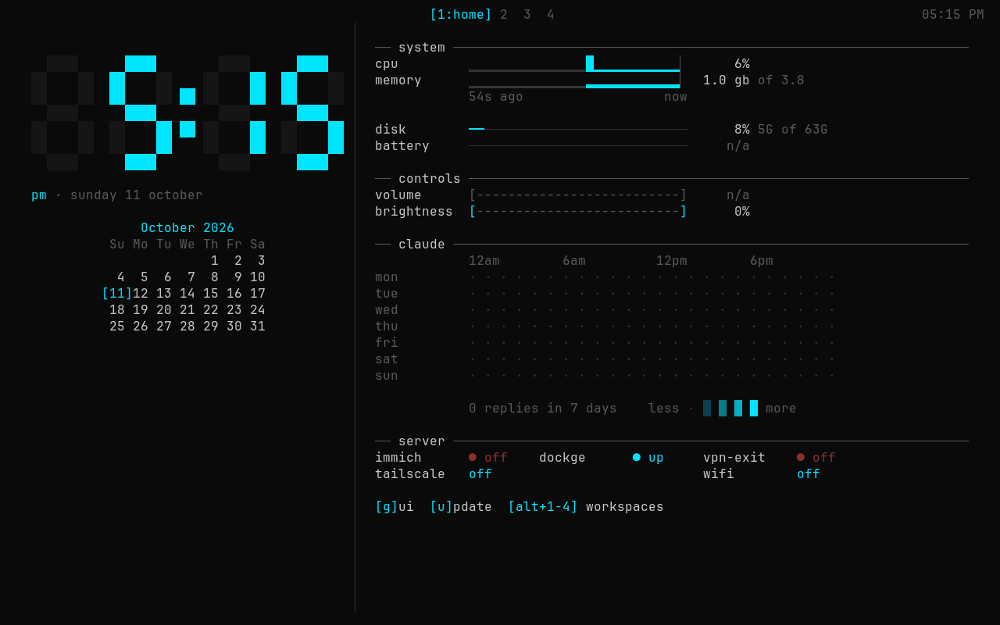

# Oracle

A minimal, keyboard-driven Linux distribution built on Arch. It boots into a fast, all-text home screen, and a full desktop is one key away when you need it.

Named after Batman's Oracle: your machine is the Batcomputer.



## Why Oracle

- **Light like plain Arch.** No desktop environment running all the time. Every package has to earn its place.
- **Text first.** You land on a dashboard and a terminal. Hyprland starts only when you ask for it.
- **Home-server ready.** Docker, Immich, Tailscale and a VPN exit node, set up for you, with backup and restore built in.
- **Secure by default.** Full-disk encryption that unlocks itself through the TPM chip, so the machine comes back on its own after a power cut.
- **Yours to change.** Your settings live in your own files. Updates never overwrite them.

## Install

You need a UEFI computer, a USB stick, an internet connection and a disk you're happy to erase completely.

1. Download the latest `oracle-*.iso` from [Releases](https://github.com/nlanhson/oracle/releases).
2. Write it to the USB stick with [balenaEtcher](https://etcher.balena.io) or `caligula`.
3. Boot from the USB stick. The installer starts by itself and asks:
   - Wi-Fi network and password (only if you're not connected)
   - which disk to erase
   - your username, time zone and keyboard layout
   - one password (for your user, the admin account and the disk)
4. Wait about 15 minutes. **Write down the recovery key** shown at the end.
5. Remove the USB stick and restart. Log in.

**Already running Arch?** Run this as your normal user instead:

```sh
curl -fsSL https://raw.githubusercontent.com/nlanhson/oracle/main/install.sh | bash
```

## Using Oracle

After you log in, you're in **Shell mode**: the home dashboard plus terminal sessions (tmux).

| Do this | To |
|---|---|
| `g` on the dashboard, or `oracle gui` | Open the desktop (Hyprland) |
| `Super + M`, or `oracle shell` | Go back to Shell mode |
| `Super + Enter` | Terminal (in the desktop) |
| `Super + B` | Brave browser (in the desktop) |
| `oracle update` | Update Oracle and the whole system |
| `oracle backup <folder>` | Back up the home server (photos, database, settings) |
| `oracle restore <folder>` | Bring the home server back from a backup |

## Manual

- [Getting started](docs/manual/getting-started.md)
- [Keys](docs/manual/keys.md)
- [Updating](docs/manual/updating.md)
- [Backup and home server](docs/manual/backup.md)

## Your settings

Oracle's defaults live in `~/.local/share/oracle/default/`. Your own changes go in:

- `~/.config/hypr/hyprland.lua` (desktop and keybinds)
- `~/.config/ghostty/config` (terminal)
- `~/.config/tmux/tmux.conf` (terminal sessions)

Each of these files first loads Oracle's defaults, then applies your changes. `oracle update` refreshes the defaults and never touches your files.

## Status

Oracle is young. The full install is tested end to end in a virtual machine: encrypted disk, TPM unlock, desktop, dashboard and home server. Real-hardware testing is in progress. Expect rough edges, and please report them.

## Contributing

Ideas, bug reports and pull requests are welcome. Open an [issue](https://github.com/nlanhson/oracle/issues) first for big changes. To test changes without touching your computer, run `test/vm.sh` (needs Docker and KVM).

## Credits

- [Arch Linux](https://archlinux.org), [Hyprland](https://hypr.land), [Ghostty](https://ghostty.org), [tmux](https://github.com/tmux/tmux), [cage](https://github.com/cage-kiosk/cage)
- The dashboard's look is inspired by [ascii.rest](https://ascii.rest) (MIT) by [@bas3line](https://github.com/bas3line).
- The update and settings model is inspired by [Omarchy](https://omarchy.org).

## License

[MIT](LICENSE)
